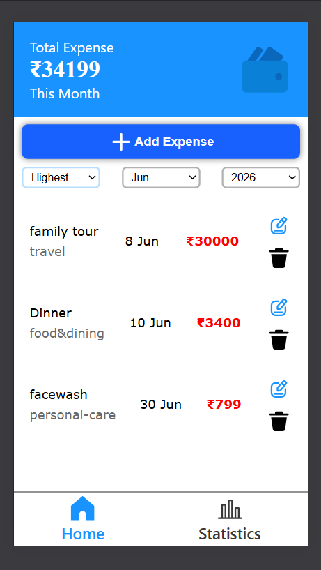
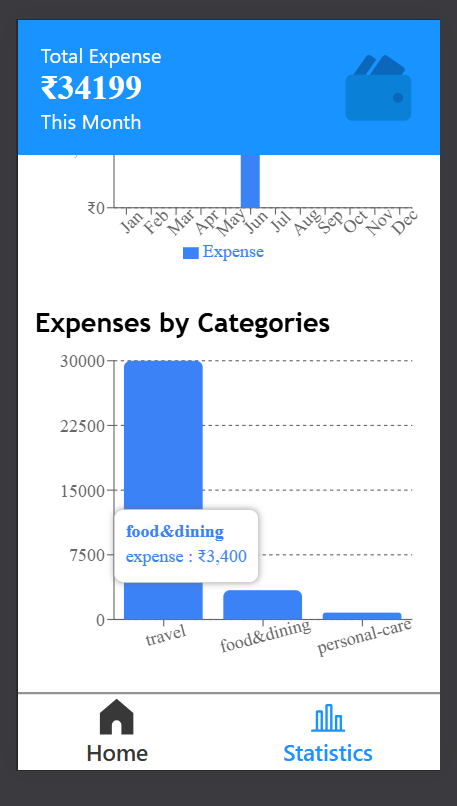
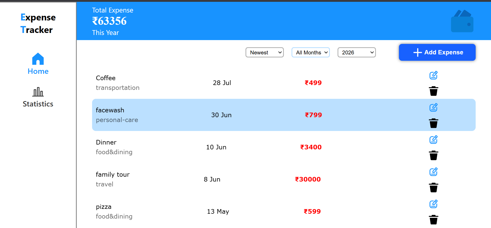
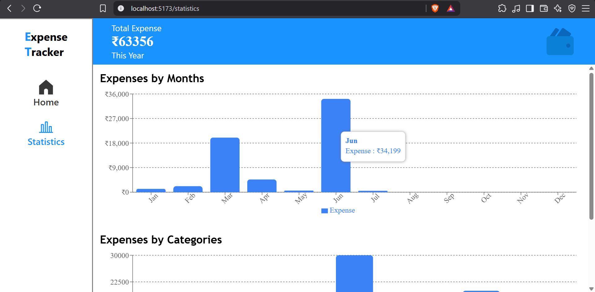

# Expense Tracker

A full-stack Expense Tracker web application built with **React**, **Express.js**, and **MongoDB**. It helps users manage their daily expenses by allowing them to add, edit, delete, filter, and sort expenses. The application also provides visual insights through interactive bar charts, making it easier to analyze spending patterns.

---

##  Features

- Add new expenses
- Edit existing expenses
- Delete expenses
- Filter expenses by a specific month or view expenses for the entire year
- Sort expenses by:
  - Newest
  - Oldest
  - Highest Amount
  - Lowest Amount
- Visualize monthly expenses using a bar chart
- Visualize category-wise expenses using a bar chart
- Responsive design for both **mobile** and **desktop** devices

---

##  Technologies Used

### Frontend
- React
- HTML
- CSS
- JavaScript

### Backend
- Node.js
- Express.js
- RESTful API

### Database
- MongoDB
- Mongoose

### Version Control
- Git
- GitHub

---

##  Installation

### 1. Clone the repository

```bash
git clone <repository-url>
```

### 2. Navigate to the project directory

```bash
cd expense-tracker
```

### 3. Install dependencies

#### Backend

```bash
cd backend
npm install
```

#### Frontend

```bash
cd ../frontend
npm install
```

---

##  Environment Variables

Create a `.env` file inside the **backend** folder and add the following variables:

```env
MONGO_URI=your_mongodb_connection_string
PORT=5000
```

---

##  Running the Project

### Start the backend server

```bash
cd backend
npm start
```

### Start the frontend

```bash
cd frontend
npm run dev
```

---

##  Usage

This application helps users:

- Track daily expenses
- Organize expenses efficiently
- Filter expenses by month or year
- Sort expenses based on different criteria
- Analyze monthly and category-wise spending through interactive bar charts

---

##  Screenshots

> **Home Page Mobile**



---

> **Statistics Page Mobile**



---

> **Home Page Desktop**



---

> **Statistics Page Desktop**



---

##  Future Improvements

- User authentication
- Show the expense description as a tooltip when hovering over an expense
- Dark mode
- More statistical charts and analytics
- Monthly budget planning and budget tracking

---

##  Author

**Baljinder Singh**